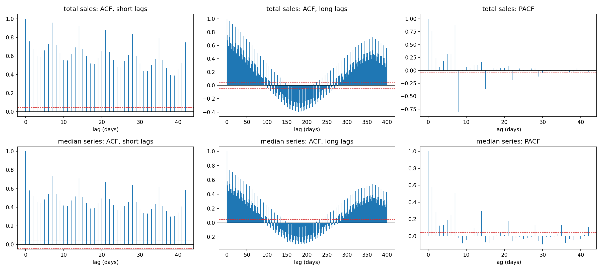
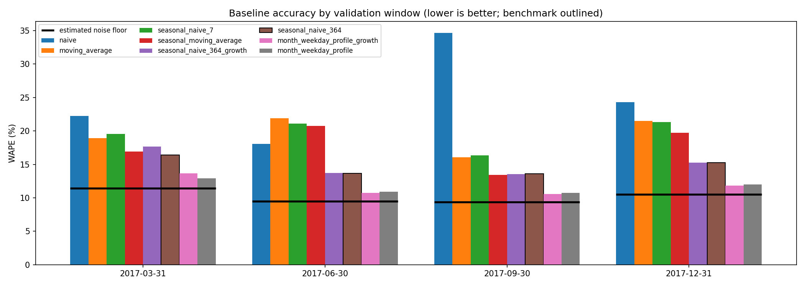

# Retail Sales & Demand Forecasting

Forecast daily unit sales for every store and item for the next 90 days, so a retail chain can plan
inventory, staffing and promotions. Dataset: Kaggle *Store Item Demand Forecasting Challenge*
(10 stores x 50 items = 500 series, 2013-2017).

## Status

- [x] Step 1: Business understanding (project brief, metrics, config)
- [x] Step 2: Data preparation (validation, complete store-item-day grid, calendar features, time-based windows)
- [x] Step 3: Time series EDA (trend, seasonality, holidays, intermittency, ACF/PACF, STL, stationarity)
- [x] Step 4: Baseline models (8 baselines on 4 validation windows, noise-floor estimate)
- [ ] Step 5: Statistical models
- [ ] Step 6: Machine learning (LightGBM)
- [ ] Step 7: Tuning and ensembling
- [ ] Step 8: Business application
- [ ] Step 9: Dashboard and deployment

## Key decisions (Step 1)

- **Granularity:** store x item x day (500 series).
- **Horizon:** 90 days, matching the Kaggle test period (2018-01-01 to 2018-03-31); error is also
  reported for days 1-28, 29-60 and 61-90.
- **Primary metric:** WAPE. Also sMAPE (the Kaggle metric), MAE, RMSE and bias.
- **Validation:** time-based only. 90-day windows ending 2017-03-31 (same season as the test period),
  2017-06-30, 2017-09-30 and 2017-12-31.
- **Benchmark to beat:** the same weekday one year earlier (364-day seasonal naive).
- **Target:** 10-20% lower WAPE than the benchmark, stable across windows. Step 4 showed that a simple baseline
  already reaches this, so later models are judged against the best baseline instead (see below).

## Findings from the time series EDA (Step 3)


- **Trend:** yearly sales grew 15.0% (2014), 4.4% (2015), 8.6% (2016) and 3.6% (2017). The 2017 growth is almost
  the same for every series (median 3.7%, 5th-95th percentile 1.9-5.4%), so one shared trend fits all of them.
- **Weekly pattern:** Monday is the low (0.79x the average) and Sunday the high (1.19x), a 50% swing, identical
  every year.
- **Yearly pattern is a staircase:** the level is flat inside a month (0.2% drift) and jumps by about 11.6% on
  average at every month boundary (January 0.68x, July 1.28x, December back down to 0.75x). Smooth yearly curves
  (Fourier terms, Prophet's default) will blur these steps, so month needs to be an explicit feature.
- **One seasonal shape for all series:** every series' weekday and month profile correlates at least 0.988 with the
  average profile, which supports a single global model.
- **No holiday effects:** all 18 tested holidays are within about 1% of a normal day (ordinary noise is 0.7%), so no
  holiday features are needed. A first version of this test showed a fake +15% effect on Thanksgiving: the
  comparison days fell in December, where sales drop 30% because of the month step. Comparing each day with the
  same weekday in the same month fixed it.
- **No intermittent demand:** all 500 series are classed smooth; there is one zero-sales day in 913,000 rows.
- **Autocorrelation:** lag 7 is 0.96 and lag 364 is 0.72 for total sales, but lag 365 is only 0.53, so the yearly
  cycle lines up on the same weekday (364 days), which supports the 364-day benchmark.
- **Decomposition and stationarity:** an MSTL decomposition of total sales gives trend strength 0.99, weekly
  strength 0.99 and yearly strength 0.997 (residuals are small for the total; individual series are noisier). The
  level is not stationary (KPSS p = 0.01), but a 7-day difference makes it stationary (ADF p < 0.001, KPSS
  p >= 0.10). The same holds for single series: in a random sample of 50, none is stationary in level and all 50
  are stationary after a 7-day difference, so ARIMA-family models start from a seasonal difference of 7 days.



Modelling implications: use month and day-of-week as explicit features, train one global model across all series,
model sales as level x seasonality x trend (log scale), add no holiday features, and skip intermittent-demand
methods.

## Baseline results (Step 4)

Every baseline forecasts the 90 days of each validation window using only the history before it. WAPE in percent
(lower is better); the last column is the improvement over the 364-day benchmark (negative = worse).

| Baseline | 2017-03-31 | 2017-06-30 | 2017-09-30 | 2017-12-31 | Mean | vs benchmark |
|---|---|---|---|---|---|---|
| naive (last day) | 22.21 | 18.07 | 34.63 | 24.29 | 24.80 | -70.2% |
| moving average (28 days) | 18.93 | 21.90 | 16.04 | 21.51 | 19.59 | -33.5% |
| seasonal naive (7 days) | 19.57 | 21.07 | 16.32 | 21.32 | 19.57 | -33.2% |
| seasonal moving average (4 weeks) | 16.94 | 20.76 | 13.42 | 19.72 | 17.71 | -20.7% |
| **seasonal naive (364 days), the benchmark** | 16.43 | 13.66 | 13.61 | 15.29 | 14.74 | 0% |
| 364 days x growth | 17.66 | 13.70 | 13.57 | 15.27 | 15.05 | -1.9% |
| **month-weekday profile** | 12.91 | 10.89 | 10.77 | 12.01 | **11.65** | **+21.0%** |
| month-weekday profile x growth | 13.66 | 10.72 | 10.57 | 11.81 | 11.69 | +20.9% |
| *estimated noise floor* | 11.43 | 9.50 | 9.38 | 10.52 | *10.21* | |



- **The month-weekday profile is the baseline to beat.** It forecasts each day as last year's average for the same
  month and weekday. That one line of reasoning follows directly from the EDA (flat level inside a month), and it
  cuts WAPE from 14.74% to 11.65%, a 21% improvement that is stable across windows (standard deviation 0.88). Its
  sMAPE, the Kaggle metric, is 13.4.
- **Why the 364-day benchmark loses:** it copies one day of last year, so it inherits that day's random noise on top
  of the noise in the day being forecast. Averaging the 4-5 matching days removes most of the first part.
- **Accuracy does not fade with the horizon:** the profile's WAPE is 11.8%, 11.6% and 11.7% for days 1-28, 29-60 and
  61-90, so a 90-day forecast is as accurate as a 28-day one (the level is predictable; the error is daily noise).
- **Growth scaling fixes bias but not accuracy.** Without it the profile under-forecasts by about 3.7% in every
  window. With it the bias is about zero in three windows, but it overshoots by 4.9% in the Q1-2017 window, because
  growth had slowed since the quarter used to measure it. WAPE is the same either way (11.65% vs 11.69%).
- **Little room is left:** the noise floor (the best any forecaster could do on this daily noise) is estimated at
  10.2%, so at most about 12% more improvement over the best baseline is possible. The 10-20% target against the
  benchmark corresponds to 13.1-14.8% WAPE in the Q1-2017 window; the profile already gets 12.9%.
- **Method note:** the growth window (91 days) was picked after comparing 28, 91, 182 and 364 days on these windows
  (mean WAPE within 0.2 points), so the growth baselines are very slightly tuned on the validation data.

## Setup

Download `train.csv`, `test.csv` and `sample_submission.csv` from the Kaggle competition into `data/raw/`.

```powershell
python -m venv .venv
.venv\Scripts\Activate.ps1
pip install -r requirements.txt
pytest
python -m forecast.prepare    # validate, clean and write data/processed/sales_prepared.parquet
python -m forecast.eda        # figures in reports/figures and reports/eda_summary.json
python -m forecast.run_baselines   # backtest all baselines: reports/baseline_results.csv and summary
```

`python -m forecast.prepare` also writes `reports/data_quality.json` (row counts, date ranges, zero/negative/missing
days, memory before and after downcasting, validation windows). Flags: `--raw-dir`, `--processed-dir`,
`--reports-dir`, `--log-level DEBUG`.

`python -m forecast.eda` reads the prepared parquet and writes the figures and `reports/eda_summary.json`. Flags:
`--prepared-path`, `--reports-dir`, `--log-level` and `--skip-statsmodels` (skips the MSTL decomposition and the
ADF/KPSS tests).

## Structure

```
forecast/     config.py (all settings), metrics.py (WAPE, sMAPE, MAE, RMSE, bias, error by group),
              data.py (load, validate, clean, complete grid), features.py (calendar features),
              splits.py (time-based validation windows), prepare.py (Step 2 pipeline),
              holidays.py (holiday calendar), timeseries.py (ACF/PACF, MSTL, ADF/KPSS),
              eda.py (Step 3 pipeline), wide.py (series x day matrices), baselines.py (8 baselines),
              backtest.py (scoring, noise floor), run_baselines.py (Step 4 pipeline), logging_utils.py
tests/        pytest suite
docs/images/  figures used in this README
data/raw/     Kaggle files (git-ignored)
data/processed/  prepared parquet (git-ignored, recreated by forecast.prepare)
reports/      generated figures and JSON summaries (git-ignored)
```
