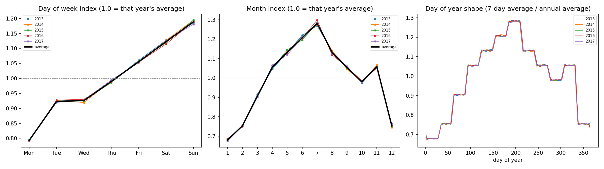
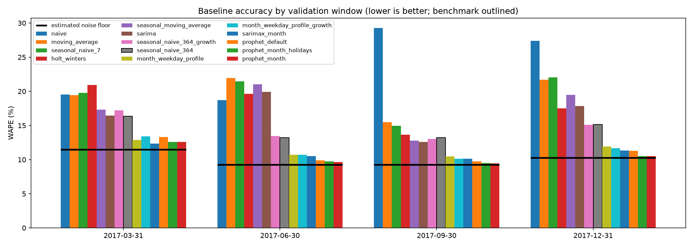
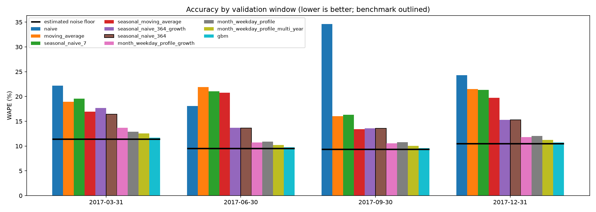
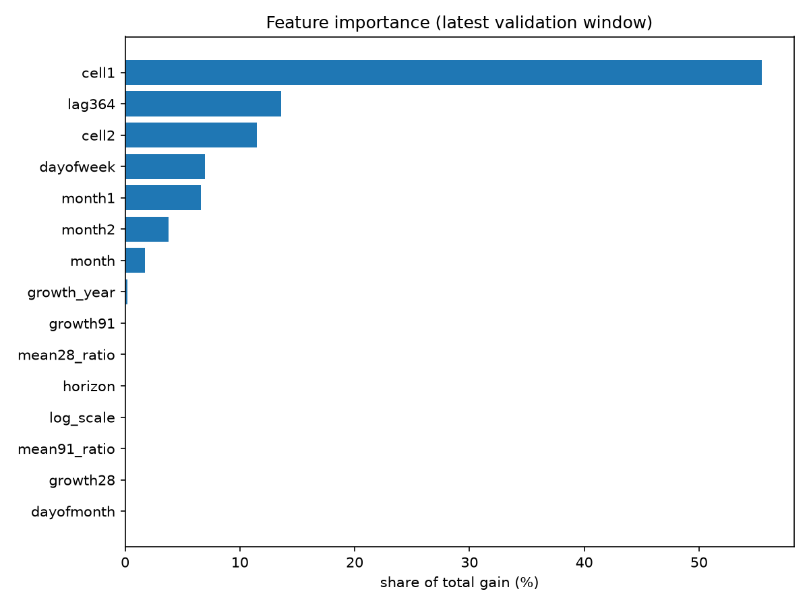
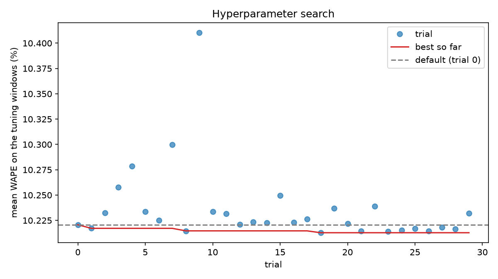
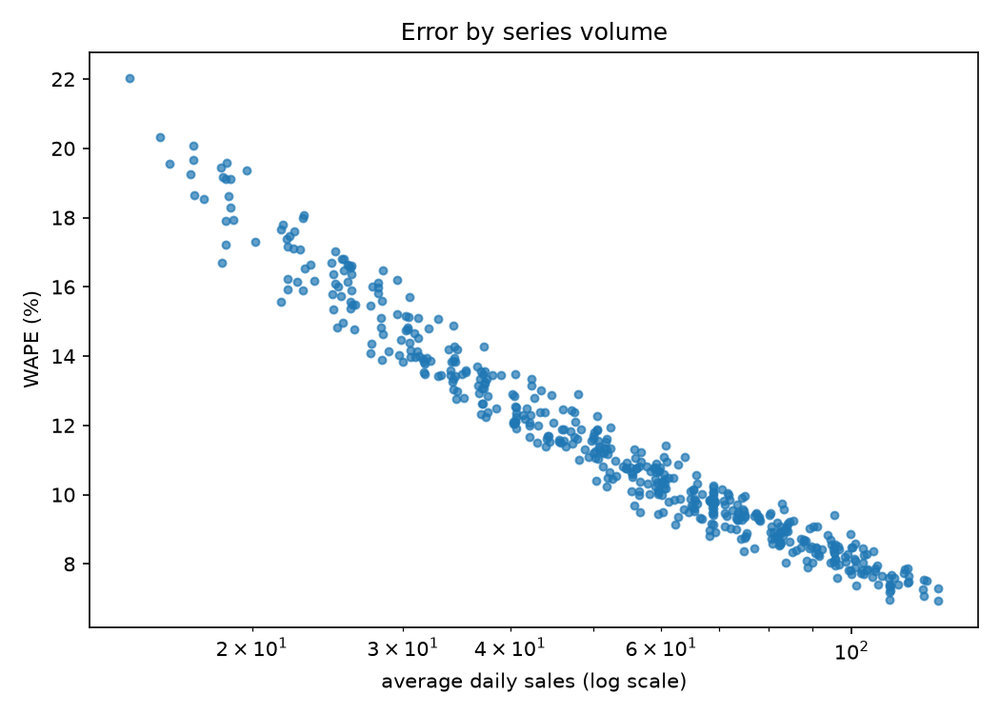
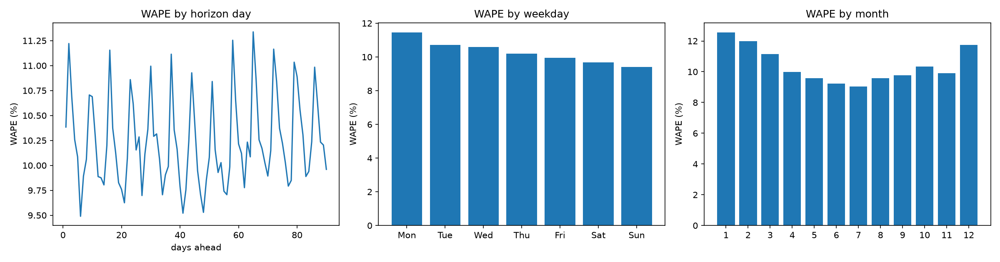
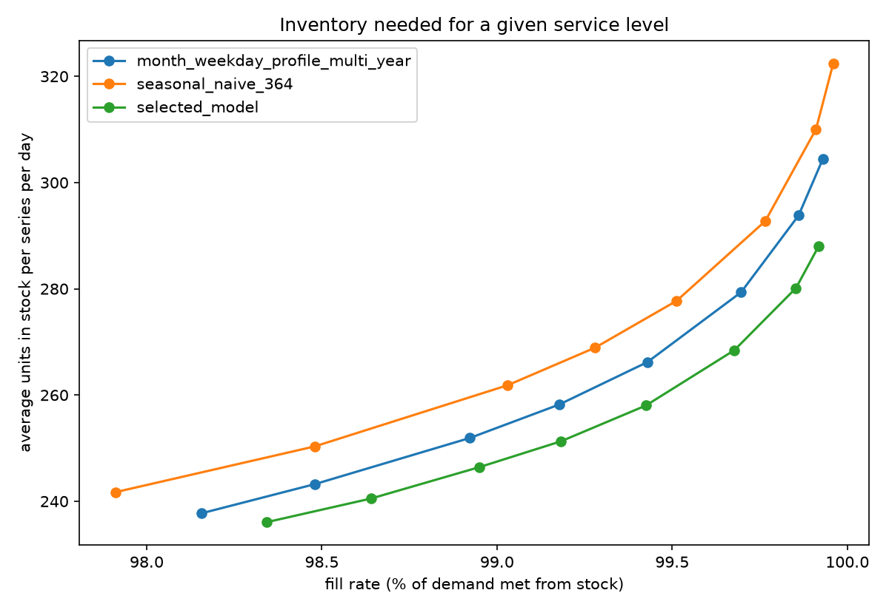
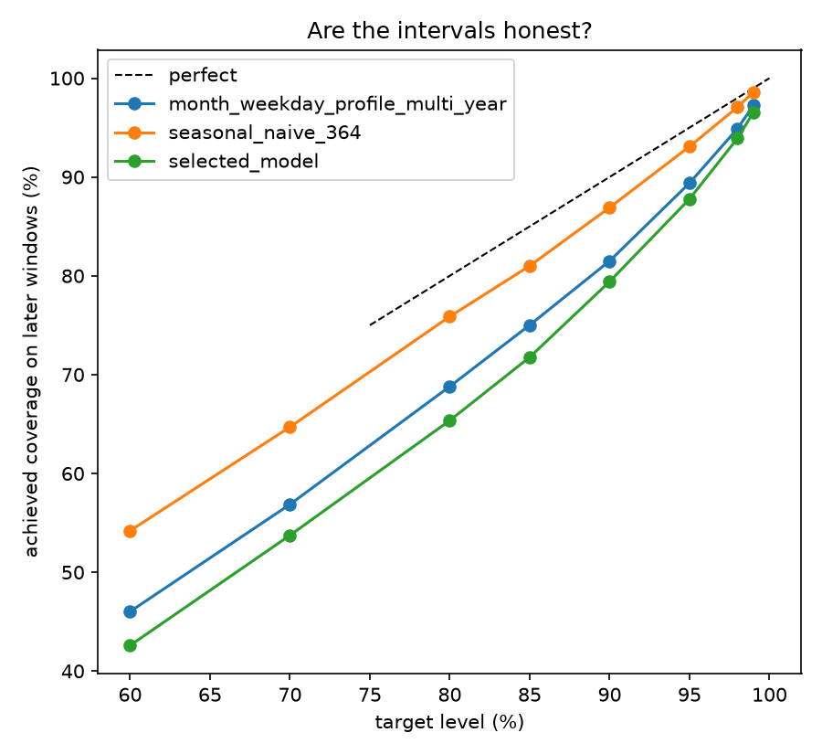
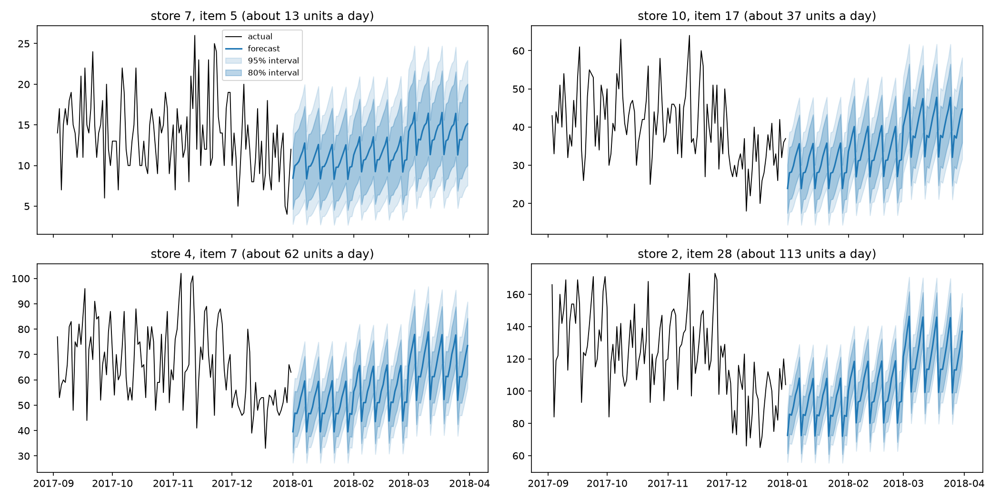

# Retail Sales & Demand Forecasting
**Live dashboard:** https://retail-demand-forecast-lalit.streamlit.app/
Forecast daily unit sales for every store and item for the next 90 days, so a retail chain can plan
inventory, staffing and promotions. Dataset: Kaggle *Store Item Demand Forecasting Challenge*
(10 stores x 50 items = 500 series, 2013-2017).

## Status

- [x] Step 1: Business understanding (project brief, metrics, config)
- [x] Step 2: Data preparation (validation, complete store-item-day grid, calendar features, time-based windows)
- [x] Step 3: Time series EDA (trend, seasonality, holidays, intermittency, ACF/PACF, STL, stationarity)
- [x] Step 4: Baseline models (9 baselines on 4 validation windows, noise-floor estimate)
- [x] Step 5: Statistical models (Holt-Winters, SARIMA(X) and Prophet on a 10-series sample)
- [x] Step 6: Machine learning (global LightGBM on all 500 series)
- [x] Step 7: Tuning, calibration and error analysis (final model selected)
- [x] Step 8: Business application (reorder plan, prediction intervals, inventory savings)
- [x] Step 9: Dashboard, monitoring and monthly refresh

## Results at a glance

All 500 series, four 90-day validation windows in 2017, WAPE in percent (lower is better).

| Model | Mean WAPE | vs 364-day benchmark |
|---|---|---|
| 364-day seasonal naive (the benchmark) | 14.74 | 0% |
| two-year month-weekday profile (best baseline) | 11.01 | 25.3% lower |
| default LightGBM (one global model) | 10.46 | 29.1% lower |
| **tuned and bias-calibrated LightGBM (final model)** | **10.36** | **29.7% lower** |
| *estimated noise floor* | *10.2* | |

In inventory terms the final model needs **5.8% less stock than the benchmark (3.2% less than the best baseline) for the
same fill rate**, and 4.2-6.6% lower total cost at each forecaster's best service level under placeholder costs.

What the project shows:

1. **The EDA did most of the work.** Finding that the level is flat inside a month, steps about 11.6% at each month
   boundary and shows no holiday effect led to a baseline with no machine learning (last two years' average for the same
   month and weekday) that is already 25% better than the benchmark.
2. **A global model adds about 6% more** by pooling the seasonal shape across all 500 series and several years.
3. **The model is close to the limit of the data.** Tuning added 0.017 WAPE points, calibration 0.083, blending nothing, and
   the remaining error follows series size almost exactly as random (Poisson) noise would (rank correlation -0.985).
4. **Models that cannot see the monthly steps fail:** Holt-Winters and SARIMA scored 16.7-17.9% on a 10-series sample, worse
   than the plain benchmark; Prophet with month terms matched the best baselines.
5. **A better forecast pays off as lower inventory**, not fewer stock-outs: demand over a 14-day protection interval is
   so predictable that fill rates are 99-99.9% at every service level.

## Key decisions (Step 1)

- **Granularity:** store x item x day (500 series).
- **Horizon:** 90 days, matching the Kaggle test period (2018-01-01 to 2018-03-31); error is also
  reported for days 1-28, 29-60 and 61-90.
- **Primary metric:** WAPE. Also sMAPE (the Kaggle metric), MAE, RMSE and bias.
- **Validation:** time-based only. 90-day windows ending 2017-03-31 (same season as the test period),
  2017-06-30, 2017-09-30 and 2017-12-31.
- **Benchmark to beat:** the same weekday one year earlier (364-day seasonal naive).
- **Target:** 10-20% lower WAPE than the benchmark, stable across windows. Step 4 showed that a simple baseline
  already reaches this, so later models are judged against the best baseline instead (see below).

## Findings from the time series EDA (Step 3)



- **Trend:** yearly sales grew 15.0% (2014), 4.4% (2015), 8.6% (2016) and 3.6% (2017). The 2017 growth is almost
  the same for every series (median 3.7%, 5th-95th percentile 1.9-5.4%), so one shared trend fits all of them.
- **Weekly pattern:** Monday is the low (0.79x the average) and Sunday the high (1.19x), a 50% swing, identical
  every year.
- **Yearly pattern is a staircase:** the level is flat inside a month (0.2% drift) and jumps by about 11.6% on
  average at every month boundary (January 0.68x, July 1.28x, December back down to 0.75x). Smooth yearly curves
  (Fourier terms, Prophet's default) will blur these steps, so month needs to be an explicit feature.
- **One seasonal shape for all series:** every series' weekday and month profile correlates at least 0.988 with the
  average profile, which supports a single global model.
- **No holiday effects:** all 18 tested holidays are within about 1% of a normal day (ordinary noise is 0.7%), so no
  holiday features are needed. A first version of this test showed a fake +15% effect on Thanksgiving: the
  comparison days fell in December, where sales drop 30% because of the month step. Comparing each day with the
  same weekday in the same month fixed it.
- **No intermittent demand:** all 500 series are classed smooth; there is one zero-sales day in 913,000 rows.
- **Autocorrelation:** lag 7 is 0.96 and lag 364 is 0.72 for total sales, but lag 365 is only 0.53, so the yearly
  cycle lines up on the same weekday (364 days), which supports the 364-day benchmark.
- **Decomposition and stationarity:** an MSTL decomposition of total sales gives trend strength 0.99, weekly
  strength 0.99 and yearly strength 0.997 (residuals are small for the total; individual series are noisier). The
  level is not stationary (KPSS p = 0.01), but a 7-day difference makes it stationary (ADF p < 0.001, KPSS
  p >= 0.10). The same holds for single series: in a random sample of 50, none is stationary in level and all 50
  are stationary after a 7-day difference, so ARIMA-family models start from a seasonal difference of 7 days.


Modelling implications: use month and day-of-week as explicit features, train one global model across all series,
model sales as level x seasonality x trend (log scale), add no holiday features, and skip intermittent-demand
methods.

## Baseline results (Step 4)

Every baseline forecasts the 90 days of each validation window using only the history before it. WAPE in percent
(lower is better); the last column is the improvement over the 364-day benchmark (negative = worse).

| Baseline | 2017-03-31 | 2017-06-30 | 2017-09-30 | 2017-12-31 | Mean | vs benchmark |
|---|---|---|---|---|---|---|
| naive (last day) | 22.21 | 18.07 | 34.63 | 24.29 | 24.80 | -70.2% |
| moving average (28 days) | 18.93 | 21.90 | 16.04 | 21.51 | 19.59 | -33.5% |
| seasonal naive (7 days) | 19.57 | 21.07 | 16.32 | 21.32 | 19.57 | -33.2% |
| seasonal moving average (4 weeks) | 16.94 | 20.76 | 13.42 | 19.72 | 17.71 | -20.7% |
| **seasonal naive (364 days), the benchmark** | 16.43 | 13.66 | 13.61 | 15.29 | 14.74 | 0% |
| 364 days x growth | 17.66 | 13.70 | 13.57 | 15.27 | 15.05 | -1.9% |
| month-weekday profile (last year) | 12.91 | 10.89 | 10.77 | 12.01 | 11.65 | +21.0% |
| month-weekday profile x growth | 13.66 | 10.72 | 10.57 | 11.81 | 11.69 | +20.9% |
| **month-weekday profile, 2 years pooled** | 12.56 | 10.21 | 10.02 | 11.23 | **11.01** | **+25.4%** |
| *estimated noise floor* | 11.43 | 9.50 | 9.38 | 10.52 | *10.21* | |


- **The two-year month-weekday profile is the baseline to beat.** Each day is forecast as the average for the same
  month and weekday in each of the last two years, scaled by that year's growth, then averaged. It follows directly
  from the EDA (flat level inside a month) and cuts WAPE from 14.74% to 11.01%, a 25% improvement, with a stable
  spread across windows (standard deviation 1.01) and a Kaggle-metric sMAPE of 12.64.
- **Pooling years matters.** The one-year version scores 11.65%. A single month-weekday average is only 4-5 days of
  noisy data, so averaging a second year cuts about 5% more error.
- **Why the 364-day benchmark loses:** it copies one day of last year, so it inherits that day's random noise on top
  of the noise in the day being forecast.
- **Accuracy does not fade with the horizon:** the two-year profile scores 11.1%, 11.0% and 11.1% for days 1-28,
  29-60 and 61-90, so a 90-day forecast is as accurate as a 28-day one (the level is predictable; the error is
  daily noise).
- **Growth scaling fixes bias but not accuracy.** Without it the one-year profile under-forecasts by about 3.7% in
  every window. With it the bias is near zero in three windows, but the Q1-2017 window overshoots (+3.2% to +4.9%)
  because growth had slowed since the quarter used to measure it. WAPE is about the same either way.
- **Little room is left:** the noise floor (the best any forecaster could do on this daily noise) is estimated at
  10.2%, so at most about 7% more improvement over the best baseline is possible. The 10-20% target against the
  benchmark corresponds to 13.1-14.8% WAPE in the Q1-2017 window; the two-year profile already gets 12.6%.
- **Method notes:** the growth window (91 days) and the number of pooled years (2) were picked on these validation
  windows (neighbouring settings differ by under 0.2 points on average), so those baselines are very slightly tuned
  on the validation data. The noise floor is an estimate, not an exact bound.

## Statistical models (Step 5)

Holt-Winters, SARIMA and Prophet are fitted one series at a time, so they run on 10 series chosen at evenly spaced
sales volumes (12.7 to 112.6 units a day), scored on the same four windows and compared with the baselines on those
same series. No fit failed.

| Model | Mean WAPE (10 series) | vs best one-year profile (11.47) |
|---|---|---|
| Holt-Winters (weekly) | 17.94 | -56.4% |
| SARIMA(1,0,1)(1,1,1,7) | 16.70 | -45.6% |
| SARIMAX + month dummies | 11.08 | +3.4% |
| Prophet, default yearly seasonality | 11.06 | +3.5% |
| **Prophet + month dummies** | **10.56** | **+7.9%** |
| Prophet + month dummies + holidays | 10.59 | +7.6% |
| *364-day benchmark (same series)* | 14.48 | |
| *two-year month-weekday profile (same series)* | 10.74 | |
| *estimated noise floor (same series)* | 10.07 | |



- **Weekly-only models fail.** Holt-Winters (17.9%) and SARIMA (16.7%) model the weekly cycle but cannot see the
  month-by-month level steps, so they are worse than the plain 364-day benchmark (14.5%).
- **Everything that can see the yearly pattern lands near 11%.** SARIMAX with month dummies (11.08%) and default
  Prophet (11.06%) are close; Prophet with month dummies is best at 10.56%. I had expected default Prophet to
  struggle with the staircase, and it did not: its flexible yearly seasonality approximates the steps well enough on
  this data.
- **Holidays add nothing** (10.59% with them versus 10.56% without), as the EDA predicted.
- **Most of the gain is pooling years, not model sophistication.** The two-year profile, which is a few lines of
  arithmetic, scores 10.74% on the same series: better than default Prophet and SARIMAX, and only 0.18 points behind
  Prophet with month dummies. Prophet does win, but by under 2% relative, and the three Prophet fits take seconds
  while SARIMAX takes a minute for no extra accuracy (fit time for 40 fits: Prophet 6.5-8.4 s, SARIMAX with months
  60 s, Holt-Winters 3.8 s).
- **Close to the floor:** the best model is within about 5% of the estimated noise floor (10.56% vs 10.07%), so there
  is little left to gain from a better model of the same kind.
- **Caution:** this is 10 series and 4 windows, so differences of a few tenths of a point between the top models
  are within sampling noise.

Step 6 tests the pooling idea properly with one global model trained on all 500 series, judged against the
two-year profile (11.01% on all series).

## Gradient-boosting model (Step 6): design

One global model is trained on all 500 series. The EDA showed that every series shares the same monthly and weekly
shape, so a single model can pool that shape across series and across years instead of estimating it separately
for each series from a few noisy days.

- **Rows:** one row per series and target day, with a forecast origin 1 to 90 days earlier (chosen at random,
  seeded). This mimics forecasting up to 90 days ahead and trains on roughly 480,000 to 650,000 rows per window.
- **Target:** the day's sales divided by the series' trailing 364-day average, so small and large series share one
  scale; rows are weighted by that average so large series count in proportion to their volume, as in WAPE.
- **Features** (all computed from data up to the origin): the log scale; recent averages and year-over-year growth
  over 28, 91 and 364 days; the sales 364 days before the target; the same-month and same-weekday average and the
  same-month average from each of the last two years; month, weekday, day of month and the forecast horizon.
  There are no holiday, price or promotion features: the data has no price or promotion columns and the EDA found no
  holiday effect.
- **No leakage by construction:** the model is refitted from scratch for every validation window using only the
  history before it, and a test checks that every feature is identical when all data after a row's origin is deleted.
- **Engine:** LightGBM (`--engine lightgbm`, the default). `--engine hist_gb` uses scikit-learn's histogram boosting,
  which needs no extra install and is the same algorithm family.

### Gradient-boosting results (Step 6)

All 500 series, four validation windows, WAPE in percent.

| Model | 2017-03-31 | 2017-06-30 | 2017-09-30 | 2017-12-31 | Mean |
|---|---|---|---|---|---|
| 364-day benchmark | 16.43 | 13.66 | 13.61 | 15.29 | 14.74 |
| two-year month-weekday profile (best baseline) | 12.56 | 10.21 | 10.02 | 11.23 | 11.01 |
| **global LightGBM** | **11.71** | **9.78** | **9.60** | **10.73** | **10.46** |



- **It beats the best baseline in every window** (5.0% lower WAPE on average) and the benchmark by 29.1%. The Kaggle
  metric sMAPE is 12.01 and the spread across windows is the smallest so far (standard deviation 0.84).
- **Horizon does not matter:** WAPE is 10.58%, 10.38% and 10.58% for days 1-28, 29-60 and 61-90.
- **It sits close to the noise floor** (estimated 10.2% on these series), so at most about 2% more improvement is
  left. The floor is an estimate, not an exact bound.
- **A consistent over-forecast of about 2%** (bias +2.7%, +2.2%, +1.9%, +1.9% by window). The growth features carry
  almost no weight, so the model cannot correct this itself; a calibration step is tested in Step 7.
- **It fits in seconds:** all four LightGBM fits took 5.7 s in total.



Gain share by feature: the same month-and-weekday average from last year 55.5%, the sales 364 days earlier 13.6%,
the same average from two years back 11.5%, day of week 7.0%, same-month averages 6.6% and 3.8%, month 1.7%.
Everything else (growth, recent averages, series scale, horizon, day of month) adds up to about 0.5%. The model
has learned the structure found in the EDA: a shared, stable seasonal shape (series size and horizon do not matter,
the level is flat within a month) and almost nothing else is needed.

### Tuning, calibration and error analysis (Step 7): design

- **Tuning without peeking:** Optuna (TPE sampler, 30 trials) searches the boosting hyperparameters using two
  90-day windows that end on 2016-09-30 and 2016-12-31, before the first validation window starts. The pipeline
  refuses to run if a tuning window reaches into validation data. The default configuration is always trial 0, so the
  search can only match or improve on it.
- **Bias calibration and blending:** for each validation window the model is also fitted on the history without its
  last 90 days and scored on those days. That pseudo-forecast sets (a) one multiplicative correction factor, limited
  to 0.9-1.1, and (b) the weight of a blend with the two-year profile baseline. Neither uses the days being forecast.
- **Parsimony rule:** five variants are compared (default, tuned, tuned + calibrated, tuned + blend, tuned +
  calibrated + blend). A more complex variant is selected only if it beats the simpler one by at least 0.05 WAPE
  points; the choice is saved to `models/gbm_params.json` for the later steps.
- **Error analysis:** WAPE and bias by series, store, item, days ahead, weekday, month and week of the month, and
  the share of series where the model beats the baseline.

### Tuning, calibration and error analysis (Step 7): results

All 500 series, four validation windows, mean WAPE in percent. "Points" are WAPE points gained over the default
LightGBM from Step 6.

| Variant | Mean WAPE | Gain (points) |
|---|---|---|
| default LightGBM (Step 6) | 10.455 | 0 |
| tuned (30 Optuna trials) | 10.438 | 0.017 |
| **tuned + bias calibration (selected)** | **10.355** | **0.100** |
| tuned + blend with the two-year profile | 10.430 | 0.025 |
| tuned + calibration + blend | 10.355 | 0.100 |

The selected model is **5.9% better than the best baseline** (11.01%) and **29.7% better than the 364-day
benchmark** (14.74%), and about 1.4% above the estimated noise floor (10.21%).



- **Tuning did almost nothing.** Over 30 trials the best score on the tuning windows was 10.213% against 10.221% for
  the default, and the gain on the validation windows was 0.017 points. The search settled on a smaller, more
  regularised model (14 leaves, 260 samples per leaf, learning rate 0.107, 431 trees), but the default was already on
  a plateau: the model is limited by noise, not by its settings.
- **Calibration is the only step that helped** (0.083 points beyond tuning). The correction factors, decided only on
  the 90 days before each window, were 1.006, 0.974, 0.983 and 0.982, which removes most of the 2% over-forecast.
- **Blending added nothing.** After calibration the best blend weight was 1.0 (all boosting model) in every window.
  The parsimony rule (a variant must gain at least 0.05 points) therefore selects the tuned and calibrated model.
- **A remaining bias in the first quarter:** over-forecasting is still about +3% in January-March (and close to zero
  from April to December). Growth slowed in 2017 (3.6% against 8.6% in 2016), so profiles built from earlier years
  run slightly high in that window.

#### Where the model is weak



- **Error is almost entirely a matter of series size.** The rank correlation between a series' sales volume and its
  WAPE is -0.985. The worst series are the smallest (store 7 item 5, 14 units a day, 22.0% WAPE), the best are the
  largest (store 2 item 15, 126 units a day, 6.9%). For a count with mean m, pure random (Poisson) noise alone gives
  a WAPE of roughly 80 / sqrt(m) percent, which is 21% for the smallest series and 7.1% for the largest. The model
  is within about a point of that, so this is irreducible noise, not a modelling weakness.
- **Every one of the 500 series beats the baseline** (share of series better than the two-year profile: 100%).
- **Stores:** WAPE runs from 9.1% (store 2) to 12.2% (store 7), following store size; bias is small (+0.4% to +0.6%)
  in every store. The five worst items (5, 4, 41, 27, 47) are all low-volume items (16.0% to 17.4%).
- **No horizon decay:** day 1 scores 10.4% and day 90 scores 10.0%.
- **Weekday and month follow volume too:** Monday (the quietest day) is the worst at 11.5% and Sunday the best at
  9.4%; January (12.6%), February and December are the weakest months and July (9.0%) the best.
- **No month-boundary problem:** WAPE is 10.2-10.3% in every week of the month, so the model handles the monthly
  level steps found in the EDA.



The selected configuration is saved to `models/gbm_params.json` for the business application in Step 8.

## Business application (Step 8): design

The forecasts are turned into ordering decisions and compared on what they cost to run.

- **Policy:** a periodic-review policy with lost sales. Every 7 days it orders enough to bring stock plus open orders
  up to the forecast demand over the next 14 days (7 days lead time plus the 7-day review period) plus a safety
  stock. Lead time, review period and the costs below are placeholders in `config.py`; replace them with the
  retailer's real values.
- **Safety stock from the forecast errors, not from an assumed distribution:** the errors of the 14-day demand
  are divided by the square root of the forecast (the Step 7 finding that the error grows with the square root of
  volume) and the safety stock is the empirical quantile of that ratio at the chosen service level.
- **No peeking:** the quantiles for each validation window come only from earlier windows, so the first window is
  used only for calibration and the simulation covers the second to fourth windows.
- **Comparison:** the selected model, the two-year profile baseline and the 364-day benchmark run through the same
  simulation at eight service levels. They are compared on (a) the inventory needed for the same fill rate and
  (b) total cost at each one's best service level, using placeholder costs (holding 0.02 per unit and day,
  a stock-out 3.0 per unit). The inventory comparison does not depend on the cost assumptions.
- **Honesty check:** the coverage the safety stock actually achieved on later windows is reported next to its target.
- **Outputs:** `reports/reorder_plan.csv` (weekly order-up-to levels for the test period),
  `reports/forecast_intervals.csv` (daily forecasts with 80% and 95% intervals), `reports/submission.csv` (Kaggle
  format) and `reports/business_summary.json`.

### Business results (Step 8)

All 500 series, simulated on the second to fourth validation windows (the first only calibrates the safety stock).
Costs are placeholders (holding 0.02 per unit and day, stock-out 3.0 per unit); the inventory comparison does not
depend on them. Inventory is the average number of units on hand per series and day.

| Forecaster | Inventory at 99.5% fill rate | Best service level | Fill rate there | Average inventory | Total cost |
|---|---|---|---|---|---|
| 364-day benchmark | 277.3 | 95% | 99.77% | 292.8 | 6.297 |
| two-year profile | 269.7 | 98% | 99.86% | 293.8 | 6.139 |
| **selected model** | **261.1** | 98% | 99.85% | **280.1** | **5.879** |



- **Less inventory for the same service:** at a 99.5% fill rate the selected model needs 5.8% less inventory than the
  benchmark and 3.2% less than the two-year profile (about 8,100 and 4,300 fewer units on hand across the 500
  series). Total cost at each forecaster's best service level is 6.6% and 4.2% lower. With the placeholder costs
  that is roughly 18,800 and 11,700 cost units per quarter; replace the costs with real ones before quoting money.
- **Fill rates are 99-99.9% at every service level.** Demand over a 14-day protection interval is very predictable,
  so stock-outs are rare either way; a better forecast pays off as lower inventory, not as fewer stock-outs.
- **The prediction intervals under-cover:** safety stocks calibrated on earlier windows achieved less than their
  nominal level on later windows (nominal 95% achieved 87.8% for the model, 93.1% for the benchmark; nominal 98%
  achieved 93.9% and 97.1%). The first window's +3% over-forecast made the model's upper quantiles too small for
  later windows. Read a nominal 98% safety stock as roughly 94%, or order against a higher level. The savings
  above are compared at the same realised fill rate, so they are not affected.



- **The plan for January-March 2018** uses the model's cost-optimal level (98%): 12 weekly orders per series, about
  2.20 million units of forecast demand, and a first-order safety stock of about 24,800 units (1.1% of the quarter's
  demand). The most heavily buffered series are the smallest ones (store 7 item 5 at 17.1%, then store 5 item 5,
  store 6 item 5 and store 7 items 27, 41, 1, 4 and 47 at 15-17% of their 14-day forecast), as the volume-error
  finding predicts.



## Dashboard and operations (Step 9)

- **Dashboard** (`app/dashboard.py`, Streamlit): five tabs. *Overview* shows the model comparison and headline savings;
  *Forecast explorer* shows any store-item series with its 80% and 95% intervals, its past accuracy against the
  benchmark and its reorder plan; *Accuracy* breaks error down by store, weekday and store-item and plots actual versus
  forecast in a validation window; *Inventory plan* lists the series needing the biggest safety buffer and offers
  the reorder plan as a download; *Monitoring* shows the accuracy log of earlier forecasts.
- **Compact data bundle:** the dashboard reads only `dashboard_data/` (about 5 MB, built by
  `python -m forecast.dashboard_data`), so it can be deployed without the raw data or the models. All charts are plain
  functions in `forecast/dashboard_data.py` and are unit-tested; the Streamlit file only wires them to widgets.
- **Monthly refresh** (`scripts/monthly_refresh.ps1`): archives the current forecast, regenerates the horizon files,
  re-prepares the data, retrains and re-plans, then checks every archived forecast against the actuals that have arrived
  since (`python -m forecast.monitor`) and refreshes the dashboard bundle. Add `-Retune` once a quarter.
- **Monitoring rules:** a forecast with at least 14 realised days raises an alert (exit code 2) when its WAPE is more than
  20% above the 10.36% backtest figure or when its nominal 95% interval covers less than 80% of actuals.
- **Scheduling and deployment:** Windows Task Scheduler and cron commands, the Streamlit Community Cloud steps and the
  data-rules caveat are in [`docs/operations.md`](docs/operations.md).

## Setup

Download `train.csv`, `test.csv` and `sample_submission.csv` from the Kaggle competition into `data/raw/`.

```powershell
python -m venv .venv
.venv\Scripts\Activate.ps1
pip install -r requirements.txt
pytest
python -m forecast.prepare    # validate, clean and write data/processed/sales_prepared.parquet
python -m forecast.eda        # figures in reports/figures and reports/eda_summary.json
python -m forecast.run_baselines   # backtest all baselines: reports/baseline_results.csv and summary
python -m forecast.run_statistical --n-series 5   # Step 5: statistical models on a sample of series
python -m forecast.run_gbm    # Step 6: global LightGBM on all 500 series vs every baseline
python -m forecast.run_tuning # Step 7: tuning, bias calibration, blending and error analysis
python -m forecast.run_business   # Step 8: reorder plan, prediction intervals, inventory savings
python -m forecast.dashboard_data # Step 9: build the compact bundle read by the dashboard
streamlit run app/dashboard.py    # dashboard at http://localhost:8501
powershell -ExecutionPolicy Bypass -File scripts\monthly_refresh.ps1   # monthly refresh (docs/operations.md)
```

`python -m forecast.prepare` also writes `reports/data_quality.json` (row counts, date ranges, zero/negative/missing
days, memory before and after downcasting, validation windows). Flags: `--raw-dir`, `--processed-dir`,
`--reports-dir`, `--log-level DEBUG`.

`python -m forecast.run_statistical` fits Holt-Winters, SARIMA and Prophet one series at a time, so it runs on a
sample of series (`--n-series`, default 10) chosen at evenly spaced sales volumes and compares them with the
baselines on the same series. The Prophet models need `pip install -r requirements-prophet.txt`; without Prophet
they are skipped. Use `--models` to run a subset.

`python -m forecast.eda` reads the prepared parquet and writes the figures and `reports/eda_summary.json`. Flags:
`--prepared-path`, `--reports-dir`, `--log-level` and `--skip-statsmodels` (skips the MSTL decomposition and the
ADF/KPSS tests).

## Structure

```
forecast/     config.py (all settings), metrics.py (WAPE, sMAPE, MAE, RMSE, bias, error by group),
              data.py (load, validate, clean, complete grid), features.py (calendar features),
              splits.py (time-based validation windows), prepare.py (Step 2 pipeline),
              holidays.py (holiday calendar), timeseries.py (ACF/PACF, MSTL, ADF/KPSS),
              eda.py (Step 3 pipeline), wide.py (series x day matrices), baselines.py (8 baselines),
              backtest.py (scoring, noise floor), run_baselines.py (Step 4 pipeline),
              statistical.py (Holt-Winters, SARIMA(X), Prophet wrappers), run_statistical.py (Step 5
              pipeline), gbm_features.py (leakage-safe features), gbm.py (global boosting model),
              run_gbm.py (Step 6 pipeline), tuning.py (Optuna search), ensemble.py (calibration and
              blending), error_analysis.py (weak-area analysis), run_tuning.py (Step 7 pipeline),
              inventory.py (safety stock, inventory simulation), selected.py (rebuild the Step 7 choice),
              business.py (savings, reorder plan, intervals, submission), run_business.py (Step 8
              pipeline), dashboard_data.py (bundle, dashboard charts), monitor.py (accuracy check of
              earlier forecasts), horizon.py (test files for new data), logging_utils.py
app/          dashboard.py (Streamlit), requirements.txt (lean, for deployment)
scripts/      monthly_refresh.ps1
tests/        pytest suite (about 150 tests, synthetic data only)
docs/          operations.md (scheduling, deployment) and images/ (figures used in this README)
data/raw/     Kaggle files (git-ignored)
data/processed/  prepared parquet (git-ignored, recreated by forecast.prepare)
reports/      generated figures and JSON summaries (git-ignored)
```

## Limitations and honest notes

- **The data looks synthetic.** A level that is flat inside each month with sharp month-boundary steps, no holiday effect and
  near-Poisson noise is unusual in real retail data. The conclusions about the monthly staircase and the noise floor may not
  transfer to a retailer with promotions, price changes and holidays.
- **One test season.** The validation windows cover 2017 only and the final forecast is for January to March 2018, the seasonal
  low. The model's remaining +3% over-forecast in that quarter (growth slowed in 2017) is a live risk.
- **Costs and lead times are placeholders.** The inventory savings in percent of stock do not depend on them; the cost figures do.
- **The prediction intervals run narrow:** a nominal 95% behaved like about 88-91% on later windows, so safety stocks are
  somewhat lower than their nominal level suggests.
- **Statistical models were tested on 10 series only** (they are slow), so differences of a few tenths of a point between them
  are within sampling noise.
- **The noise floor is an estimate**, not an exact bound.
- **Monitoring is untested on real new data:** the Kaggle history ends on 2017-12-31 and the test period has no actuals, so the
  monitor is covered by unit tests on synthetic data and starts working with the first refresh that brings new rows.
- **Dashboard deployment** needs the data bundle in the repository, which includes 400 days of the Kaggle sales; check the
  competition's data rules before making anything public.
